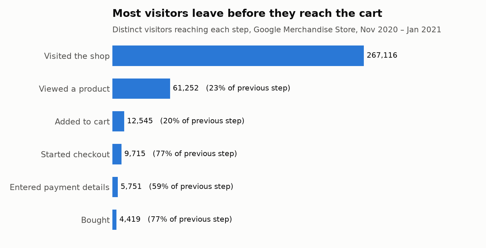
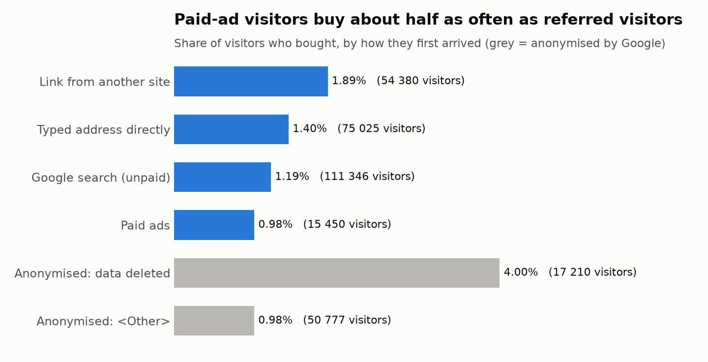
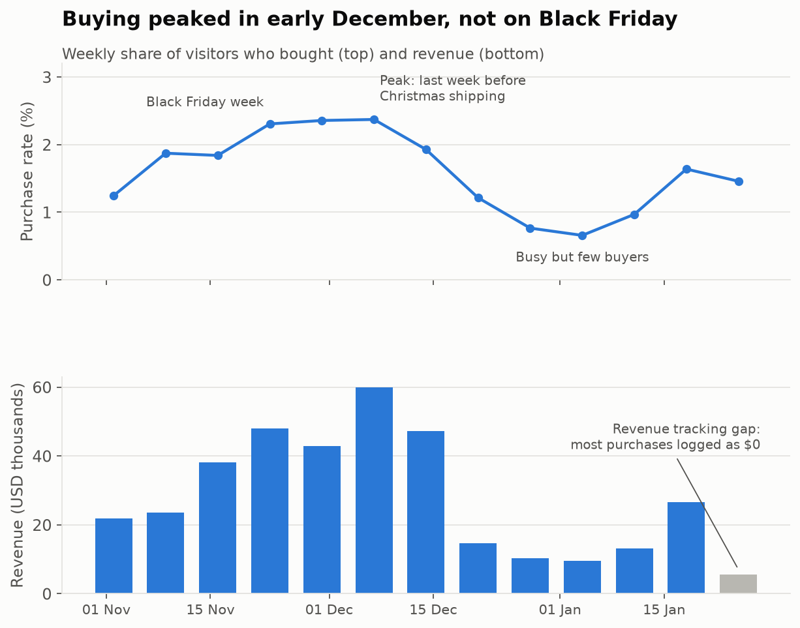

# E-commerce Funnel Analysis

**Where does an online shop lose its shoppers?** A funnel and conversion analysis of three months of real GA4 data from the Google Merchandise Store, written in SQL on BigQuery.

## The data

Google's public [GA4 e-commerce sample](https://developers.google.com/analytics/bigquery/web-ecommerce-demo-dataset) (`bigquery-public-data.ga4_obfuscated_sample_ecommerce`): every page view, add-to-cart and purchase on the Google Merchandise Store from **1 November 2020 to 31 January 2021**, stored as one table per day. Google has anonymised ("obfuscated") parts of it, which affects some results (see *Limitations*).

## Questions

1. Of everyone who visits, how many view a product, add it to the cart, check out and buy? Where is the biggest drop?
2. Does that change by device or by how visitors arrived (search, ads, referral, direct)?
3. What happened over the holiday season?

## Key findings

**1. Most shoppers are lost before the cart, not at checkout.** 77% of visitors never view a product, and 80% of product viewers never add anything to their cart. Once someone adds to cart, 77% start checkout. Overall, **1.65% of visitors bought something**.

**2. The biggest drop inside checkout is at the payment step.** 41% of people who start checkout leave before entering payment details. The data does not say why; shipping costs or other unexpected charges often first appear at this step, which makes it a good candidate for an A/B test.

**3. Device makes no clear difference.** Mobile converted at 1.71% and desktop at 1.62%. A two-proportion z-test gives p = 0.056, just above the usual 0.05 threshold, so the difference is not statistically significant ([`significance_check.py`](significance_check.py)).

**4. Paid-ad visitors buy about half as often as referred visitors** (0.98% vs 1.89%). The dataset has no ad spend, so this cannot show whether the ads pay for themselves. Joining advertising cost data would be the next step.

**5. The peak was early December, not Black Friday.** The week of 7 December had the most visitors, buyers and revenue, possibly the last week to order in time for Christmas. After 21 December sales collapse, and early January is busy (24 000+ visitors a week) but only 0.66% buy.

## Data quality check

In the last week of January, revenue per buyer fell from about US$75 to US$18. A day-by-day check ([`05_revenue_tracking_check.sql`](sql/05_revenue_tracking_check.sql)) showed that purchases kept happening at the normal rate, but from **26 January** more and more were recorded with **US$0 revenue**, reaching 100% on 31 January. This is a tracking problem, not a change in shopper behaviour, so revenue from 26 to 31 January is excluded from conclusions (shown in grey in the weekly chart). Buyer counts and purchase rates are unaffected and kept.

## Next steps in detail

**1. Sequential funnel.** The current funnel counts each step independently. A stricter version would group events by visitor and visit (`user_pseudo_id` plus the `ga_session_id` event parameter), take the earliest timestamp of each step, and only count a step if the previous step's timestamp is earlier in the same visit. This gives truer step-to-step drop-off and the time taken between steps.

**2. Cost per purchase and return on ad spend.** With ad-platform cost data joined by date and campaign:

- *Cost per acquisition* = ad spend / purchases from ad visitors. Example: 15 000 clicks at US$0.50 = US$7 500; 150 purchases → US$50 per purchase.
- *Return on ad spend* = revenue from ad visitors / ad spend. Example: 150 purchases × US$75 = US$11 250 → US$1.50 back per US$1 spent. At US$2 a click, the same clicks cost US$30 000 → about US$0.38 back per US$1.

These figures are illustrative; the dataset has no ad spend. Whether a return is good enough also depends on profit margins.

**3. A/B test: showing shipping costs earlier.**

- **Version A (control):** shipping costs appear at the payment step. **Version B:** shipping costs shown on the cart page.
- **Random assignment:** checkout visitors randomly split between A and B, run at the same time.
- **Primary metric:** checkout-to-purchase rate (currently about 45%).
- **Sample size, fixed in advance:** detecting an increase from 45% to 48% (5% significance, 80% power) needs about 4 300 checkout visitors per version, roughly three months at this shop's traffic. No stopping early because one version looks ahead.
- **Decision:** two-proportion z-test at the planned sample size; B wins only if higher with p < 0.05.
- **Guardrail metric:** overall visitor-to-purchase rate, in case showing shipping earlier puts people off adding to cart.

## Limitations

- **Funnel steps are counted independently.** Each step counts everyone who did it at any point in the three months, not people moving through the steps in strict order.
- **Anonymised traffic sources.** About a fifth of visitors are labelled `<Other>` or `(data deleted)`, and visitors per source add up to more than the total, so some visitors appear under more than one source. These rows are reported but not interpreted.
- **Observational, not experimental.** Differences between devices or sources show association, not cause. Testing a fix (for example, showing shipping costs earlier) would need an A/B test.

## Repository

| Folder / file | Contents |
|---|---|
| [`sql/`](sql/) | The five BigQuery queries, numbered in the order they were run |
| [`results/`](results/) | Each query's output as CSV |
| [`images/`](images/) | Charts |
| [`make_charts.py`](make_charts.py) | Builds the charts from `results/` |
| [`significance_check.py`](significance_check.py) | Mobile vs desktop significance test |

## Reproduce it

1. Open the free [BigQuery sandbox](https://console.cloud.google.com/bigquery) and create a project.
2. Run the queries in `sql/` in order. The dataset is public, so nothing needs to be uploaded.
3. Rebuild the charts: `pip install pandas matplotlib`, then `python make_charts.py`.

## Tools and techniques

- **SQL in Google BigQuery:** data extraction and all analysis: funnel counts, segmentation by device, traffic source and week, and the day-by-day revenue check.
- **Python (pandas, matplotlib):** the two-proportion z-test and the charts.
- **Techniques:** funnel and conversion rate analysis, segmentation, trend analysis, significance testing, data quality checks.
